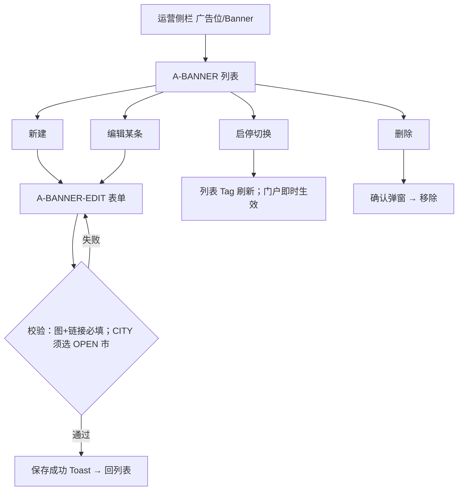
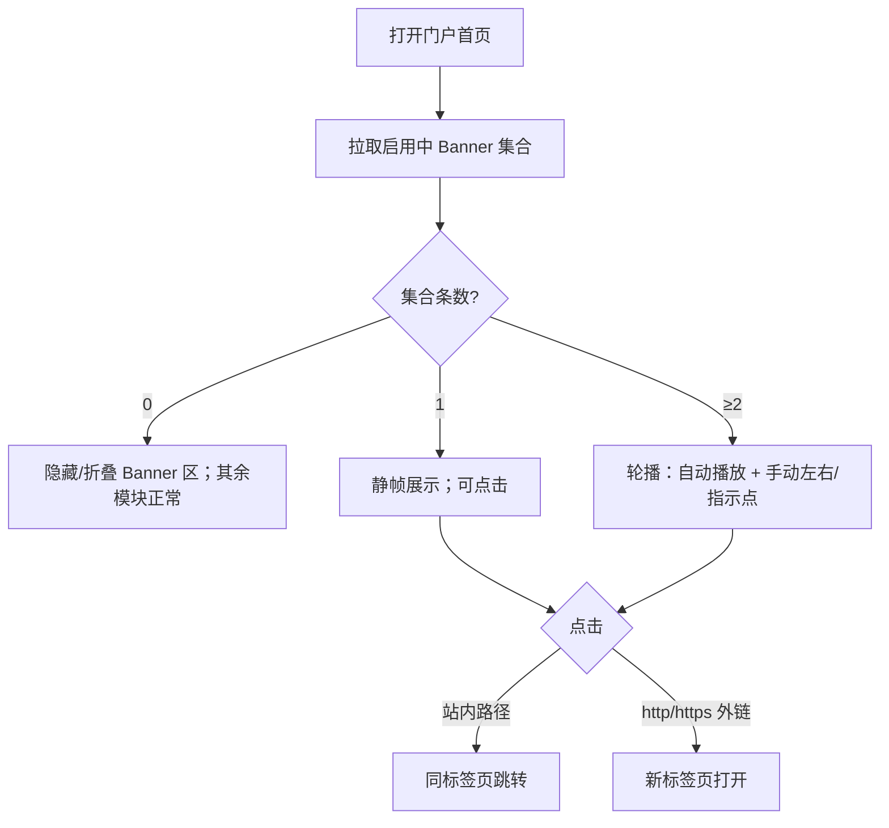

# 设计交付 · MVP-1.5 广告位

| 项 | 内容 |
|----|------|
| 文档版本 | **MVP-1.5** |
| 对齐产品 | `PRODUCT-MVP-1.5-广告位-范围.md` · `PRODUCT-MVP-分期-已拍.md` |
| 日期 | **2026-10-18** |
| 维护 | 资深 UI/UE 设计执行 |
| 状态 | 可交付前端线框实现；对齐验收 **C-Ad1～C-Ad5** |
| 品牌 | 主色沿用浅蓝 `#4BA3D9` / hover `#3A8FC4` / soft `#E8F4FC`；复用 `UI-TOKENS-MVP-0.md` |
| 边界 | 本包只做**运营配置首页 Banner** + **门户首页展示**；**无支付/买位/统计看板**；不改意向状态机；CHECKED_IN 仍「已入住」；商家无广告配置 |

---

## 1. 设计原则

沿用 MVP-0 / MVP-1 全部原则，并增加广告位专用约束：

1. **先确认**：每个流程写清「用户 / 主任务 / 入口 / 出口」；一流程只服务一个主任务。
2. **每步写清**：可见信息、可操作、操作反馈。
3. **每页覆盖**：默认 / loading / empty / error / 无权限 / 校验失败 / 窄屏。
4. **可达性**：全键盘可达、焦点序、Banner 图 `alt`、对比度 ≥ WCAG AA；轮播须可暂停/手动切换。
5. **复用**：统一设计 token 与组件（见 `UI-TOKENS-MVP-0.md`）；**不新增绿色品牌色**；启停 Tag 复用 success / neutral。
6. **文案**：运营侧用「Banner / 广告位」；对客首页**不以刺眼「广告/赞助」角标**为主视觉；可选轻量「活动」Caption（本包可不做）。
7. **广告位专用**：
   - 仅运营可配；游客只读；**商家无入口**。
   - 仅门户**首页** Banner 区；列表/详情/商家端不做插卡。
   - 投放范围 `ALL`（全站）或 `CITY`（指定 **OPEN** 市）；**CLOSED 市不可选为有效定向**（下拉禁用并提示，或过滤不出现）。
   - **全站 Banner 忽略目的地 Chip**（产品 Q3 已锁）：未选市 / 已选市同一套 ALL 集合。
   - **排序：数值越小越靠前**；同序按创建时间或稳定 id 次序即可。
   - **0 条启用 → 折叠隐藏 Banner 区**；首页搜索/目的地/推荐正常。
   - **1 条 → 静帧**；**≥2 条 → 简单自动 + 手动轮播 + 指示点**（UI 已定，见 §3.2）。
   - 外链 `http(s)` **新开标签页**；站内路径 **同标签页**跳转。

---

## 2. 角色与主任务（本包）

| 角色 | 主任务（本包一件事） | 成功出口 | 明确不能做 |
|------|---------------------|----------|------------|
| 运营 | 配置首页 Banner（图、链接、启停、排序、全站/按 OPEN 市） | 条目保存并即时影响门户展示 | 支付/买位/竞价；曝光统计看板；向 CLOSED 市做有效定向 |
| 游客 | 在首页看见启用 Banner 并可点击跳转 | 进入所配站内页或外链；无 Banner 时不影响找店/意向 | 配置广告；支付/定金 |
| 商家 | — | — | **本包无新页、无广告配置入口、无买位** |

---

## 3. 关键流程

### 3.1 A-BANNER：列表 → 新建/编辑 → 启停 / 删除



**ASCII：**

```
A-BANNER 列表
  → 新建 / 编辑 → A-BANNER-EDIT（图、链接、范围、排序、启用）→ 保存
  → 行内启停 → 即时影响门户
  → 删除 → 确认 → 移除
```

| 项 | 内容 |
|----|------|
| 用户 | 运营 |
| 主任务 | 维护首页 Banner 投放集合，使启用条目按序对客可见 |
| 入口 | 运营侧栏「广告位」或「Banner 管理」→ A-BANNER；行内进 A-BANNER-EDIT |
| 出口 | 列表反映最新启停/排序/范围；门户首页展示集合更新 |

**排序约定（写死到 UI 与验收）：** 字段「排序」为非负整数（建议默认 `100`）；**数值越小越靠前**；首页轮播起始序与列表升序一致（对 C-Ad3）。

---

### 3.2 P-HOME：Banner 展示（轮播规则）



| 项 | 内容 |
|----|------|
| 用户 | 游客 |
| 主任务 | 在首页发现运营活动/引导并跳转目标 |
| 入口 | 门户 `/`（顶栏下 Banner 区） |
| 出口 | 站内目标页（同 tab）或外链（新 tab）；无 Banner 时直接使用搜索/目的地 |

**展示集合过滤（产品 §3 + Q3）：**

1. 仅 `enabled=true`。
2. `scope=ALL`：一律入集（**与当前目的地 Chip 无关**）。
3. `scope=CITY`：仅当目标市 `openStatus=OPEN` 时入集；CLOSED / 未配置 → **不展示**。
4. 入集后按 **排序升序**（小在前）排列。

**轮播交互（UI 定稿 · 对产品 Q1）：**

| 条数 | 表现 |
|------|------|
| 0 | **整块 Banner 区不渲染**（高度折叠为 0）；不占位、不报错 |
| 1 | 单图静帧；整图可点；无指示点、无自动切 |
| ≥2 | 横向轮播；默认约 **5s** 自动下一张；支持左右箭头或触滑；底部指示点可点切帧；悬停/聚焦时暂停自动播放；键盘左右键可切换 |

**Banner 区位置（推荐定稿）：** 顶栏之下、**搜索区 / 目的地 Chip 之上**。理由：曝光优先且不打断「搜店/选目的地」主路径；空集折叠后搜索区自然顶上，布局无空洞感。

**角标：** 本包**不强制**「广告/赞助」角标；可选极轻「活动」Caption（默认不做，避免促销压迫感）。

---

## 4. 业务规则（UI 必须体现）

来自产品 §3，**不发明新 API 字段**；未知标「待工程」。

| # | 规则 | UI 体现 |
|---|------|---------|
| 1 | 仅运营可增删改启停；游客只读；商家无配置 | A-BANNER* 鉴权运营；门户无配置入口；商家导航无「广告位」 |
| 2 | 仅首页 Banner；一屏交互由 UI 定 | P-HOME 唯一新增区块；列表/详情不加广告位 |
| 3 | ALL 全站可见；CITY 仅市 OPEN 时入展示集 | 表单范围：全站 / 选 OPEN 市；CLOSED 不可选或 disabled+tip；首页过滤 CLOSED 定向 |
| 4 | 排序：数值越小越靠前；同序稳定 | 列表按排序升序展示；表单数字输入 + 旁注「数字越小越靠前」 |
| 5 | 链接：站内路径或 http(s)；外链新开页；无效链不挡展示 | 表单链接必填；点击行为按内外链分流；不做一期强制弹窗校验 URL 可达性 |
| 6 | 无启用条目 → Banner 区隐藏，首页其余正常 | 0 条不占位；搜索/目的地/推荐照常 |
| 7 | 启停即时生效（刷新后可见） | 停用后该条不再入展示集；列表启用 Tag 即时更新 |
| 8 | 硬锁：无支付/买位；不改意向；CHECKED_IN=已入住 | 全文案与导航巡检；见 §5 |

**范围 Tag（列表）：**

| 范围 | Tag 文案 | 样式 |
|------|----------|------|
| ALL | 全站 | Brand soft 底 + Brand 字 |
| CITY（OPEN） | 市名（如「扬州」） | info 或 Brand soft |
| CITY 目标已 CLOSED | 市名 + 旁注「市已关闭·不对客」 | warning / neutral；该条即使启用也不入门户展示集 |

**启用 Tag：**

| 状态 | Tag |
|------|-----|
| 启用 | success「启用」 |
| 停用 | neutral「停用」 |

---

## 5. 硬锁

| 锁 | 说明 |
|----|------|
| 无支付 / 买位 UI | 路由、导航、按钮、表单均无支付、定金、钱包、收银台、买位、竞价、合同售卖 |
| 无统计看板 | 本包不做曝光/点击报表页与计费 |
| 已入住文案 | CHECKED_IN 对客/运营展示仅「已入住」；本包不改意向状态机 |
| Token | 复用 MVP-0；Brand `#4BA3D9`；**禁用**田园绿 `#2F6B4F` 作品牌色 |
| 商家 | 无新页；无广告配置；无买位入口 |
| 投放位置 | 仅门户首页 Banner；不做列表插卡 / 详情广告 / DSP / 视频广告 |
| CLOSED 定向 | 不得作为有效新建定向；历史定向市变 CLOSED 后不对客展示 |

---

## 6. 开放问题

| # | 问题 | 结论 | 状态 |
|---|------|------|------|
| Q1 | 多图交互：单帧 vs 轮播？ | **≥2 简单自动+手动轮播+指示点；1 静帧；0 隐藏** | ✅ UI 已定 |
| Q2 | 图片必上传 vs 可填 URL？ | 工程按现有上传能力；表单支持「上传或填 URL」二选一（至少一种可用） | 交工程 |
| Q3 | 全站 Banner 是否受目的地 Chip 影响？ | **否**；ALL 与 Chip 无关 | ✅ 产品已锁 |
| Q4 | 外链是否强制 https？ | 建议 https；http 不阻断一期 | 产品默认 |
| Q5 | 对客是否展示「广告」角标？ | **默认不做**；可选轻量「活动」Caption | ✅ UI 已定（默认不做） |
| Q6 | Banner 区相对搜索的位置？ | **顶栏下、搜索/目的地之上** | ✅ UI 已定 |

无开放问题挡开发；产品可对本文做轻量门禁。

---

## 7. 页面清单（本包）

### 7.1 运营新增

| ID | 页面 | 路由建议 | 鉴权 |
|----|------|----------|------|
| A-BANNER | Banner / 广告位列表 | `/admin/banners` | 运营 |
| A-BANNER-EDIT | 新建 / 编辑 Banner | `/admin/banners/new` · `/admin/banners/:id` | 运营 |

### 7.2 门户改动（相对 MVP-0/1，非新页）

| ID | 改动要点 |
|----|----------|
| P-HOME | 顶栏下新增 Banner 区；0 隐藏 / 1 静帧 / ≥2 轮播；点击内外链分流；**ALL 忽略 Chip**；CITY 仅 OPEN 入集 |

### 7.3 商家

**本包无新页。**

详页规格见 `UI-PAGES-MVP-1.5-广告位.md`。

---

## 8. 前端实现注意点

### 8.1 路由与 page id

- 运营导航新增「广告位」或挂在「内容/配置」下：`A-BANNER`、`A-BANNER-EDIT`。
- 门户不新增路由；P-HOME 增量拉取启用 Banner 列表接口。
- page id 与路由建议上表；字段名以后端契约为准，UI 消费：图 URL、链接、enabled、sort、scope（ALL|CITY）、cityCode/cityName。

### 8.2 列表与启停（对 C-Ad1 / C-Ad2 / C-Ad3）

- 列表默认按 **sort 升序**（小在前）；同序稳定排序。
- 行内「启用/停用」切换成功后 Toast（如「已启用」「已停用」）；无需发版。
- 删除须二次确认：「删除后不可恢复，确认删除该 Banner？」
- 缩略图失败时占位图 + alt 回退为链接摘要或「Banner 图」。

### 8.3 表单校验（对 C-Ad1 / C-Ad4）

| 字段 | 规则 |
|------|------|
| 图片 | 必填：上传成功 **或** 有效图片 URL（二选一，视工程能力） |
| 链接 | 必填：以 `/` 开头的站内路径，或 `http://` / `https://` 外链 |
| 范围 | 必选：全站 **或** 指定市；选 CITY 时 **必须**选一个当前 OPEN 市 |
| CLOSED 市 | 下拉中不出现，或出现但 **disabled** 并 tip「该市未开通，不能作为投放目标」 |
| 排序 | 必填整数；旁注「数字越小越靠前」；非法非数字 → 字段下红字 |
| 启用 | Switch；新建默认建议「启用」开 |

- 保存 Primary；提交中防重复；成功 Toast「已保存」并回列表或停留可再编。
- **不做**一期强制探测链接是否 200；无效链接仍可展示，点击失败由浏览器表现。

### 8.4 首页展示过滤（对 C-Ad1～C-Ad4）

```
展示集 = enabled
  ∩ (scope==ALL ∨ (scope==CITY ∧ city.openStatus==OPEN))
  按 sort 升序
```

- ALL **不**读取当前 Chip / URL 市参。
- CITY 目标市变为 CLOSED 后，即使 enabled 也不入集（对 C-Ad4 南通用例）。
- 0 条：不渲染 Banner 容器（`display:none` 或条件不挂载）。

### 8.5 点击跳转

| 链接形态 | 行为 |
|----------|------|
| 站内相对路径（如 `/listings?city=yangzhou`） | `location` 同 tab 跳转 |
| `http://` / `https://` | `target=_blank` + `rel="noopener noreferrer"` |

### 8.6 轮播可达性与窄屏

- 自动播放须在悬停、聚焦、`prefers-reduced-motion` 时暂停或降级为静帧可手动切。
- 指示点与箭头可键盘操作；当前帧 `aria-roledescription` / 活区适度告知（避免每 5s 刷屏）。
- 图必须有 `alt`（可用运营填的标题，或默认「活动宣传」）。
- 窄屏：Banner 满宽、高度按 16:9 或 2.5:1 自适应；指示点保留；箭头可改为触滑为主。

### 8.7 无支付 / 商家巡检（对 C-Ad5）

- 运营广告配置页、门户首页、商家端：无买位、支付、钱包 CTA。
- 意向相关文案与 CHECKED_IN「已入住」本包零改动。

---

## 9. 文案硬约束（本包增量）

| 触点 | 文案方向 |
|------|----------|
| 侧栏 | 「广告位」或「Banner 管理」 |
| 列表空 | 「暂无 Banner，点击新建投放」 |
| 保存成功 | 「已保存」 |
| 停用成功 | 「已停用，首页将不再展示」 |
| 启用成功 | 「已启用」 |
| 删除确认 | 「删除后不可恢复，确认删除该 Banner？」 |
| 范围 | 「全站」/「{市名}」；CLOSED tip「该市未开通，不能作为投放目标」 |
| 排序旁注 | 「数字越小越靠前」 |
| 对客 Banner | 无强制「广告/赞助」角标；默认无 Caption |
| 禁区 | 买位、竞价、曝光报表、支付、定金、钱包；CHECKED_IN 异名；对客「上架」 |

---

## 10. 验收映射（C-Ad1～C-Ad5）

| 验收 ID | 设计对应 |
|---------|----------|
| **C-Ad1** | A-BANNER-EDIT 可配启用+全站+图+链接 → P-HOME 可见并可点进链接（内外链分流） |
| **C-Ad2** | A-BANNER 行内停用 → 刷新后首页该条消失 |
| **C-Ad3** | 多条启用不同 sort → 首页展示/轮播起始序与「越小越前」一致 |
| **C-Ad4** | CITY=扬州(OPEN) 可见；CITY=南通(CLOSED) 不出现；表单不可选 CLOSED 为有效目标 |
| **C-Ad5** | 门户+运营广告页+商家端无支付/买位；意向与「已入住」不变；商家无广告配置入口 |

---

## 11. 关联交付

| 文件 | 内容 |
|------|------|
| `UI-PAGES-MVP-1.5-广告位.md` | 本包各页信息结构、六态、文案 |
| `UI-TOKENS-MVP-0.md` | 复用；本包不单开 tokens 文件 |
| `PRODUCT-MVP-1.5-广告位-范围.md` | 范围与验收 C-Ad1～C-Ad5 |
| `DESIGN-MVP-1-开城.md` | 开城 OPEN/CLOSED 为本包按市前提 |

---

## 12. 改动点 / 影响点（老板协作规范）

| 类型 | 说明 |
|------|------|
| **新增** | 运营 A-BANNER、A-BANNER-EDIT；门户 P-HOME Banner 区（轮播/静帧/隐藏规则） |
| **门户增量** | 仅首页；位置在顶栏下、搜索之上；ALL 忽略 Chip；CITY 跟 OPEN |
| **不改** | 意向状态机、CHECKED_IN「已入住」、支付边界、商家页与权限、Brand 色板、开城 checklist |
| **配置** | 图上传或 URL（工程二选一至少一种）；排序默认建议 100；轮播间隔建议 5s |
| **风险** | ① CITY 未按 OPEN 过滤会误曝光 CLOSED 市活动（C-Ad4）；② 0 条仍占空白会挡主路径；③ 外链未新开 tab 易丢门户会话；④ 前端可选手 CLOSED 而后端未拒 → 须双端校验 |
| **协作** | UI 已定 Q1/Q5/Q6；FE 按 page id 排期；测试按 C-Ad1～C-Ad5 + 禁支付/买位巡检 |

---

## 13. 修订记录

| 版本 | 日期 | 说明 |
|------|------|------|
| MVP-1.5 | 2026-10-18 | 首版广告位设计交付；对齐老板 A★；UI 定轮播规则、排序越小越前、Banner 位在搜索之上 |
