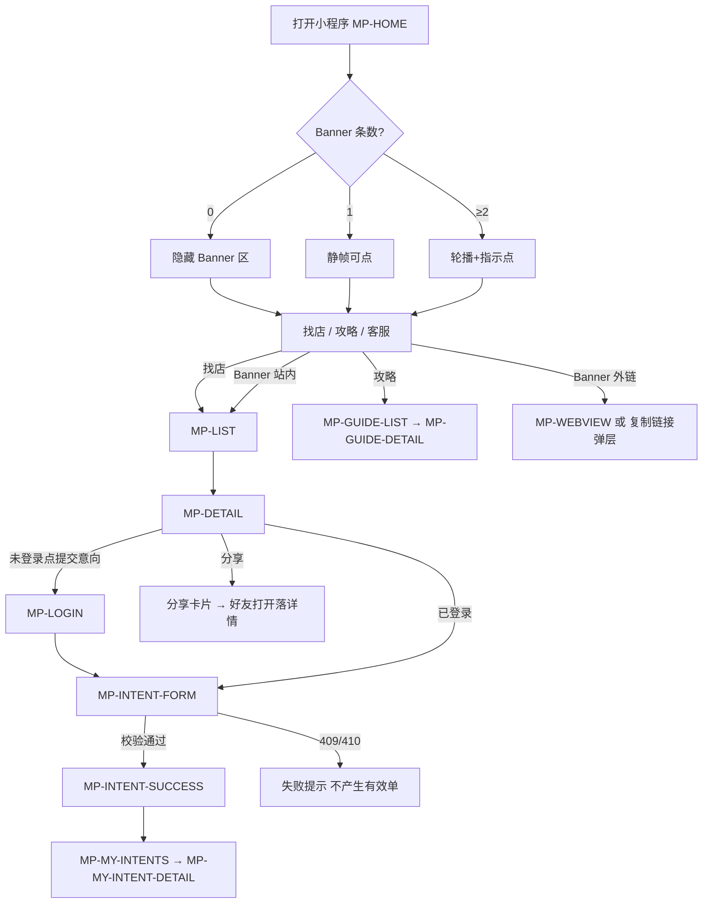
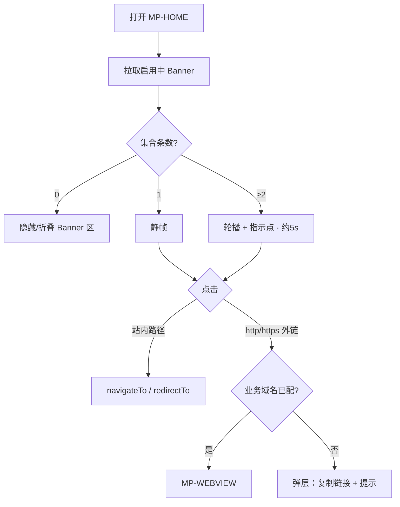
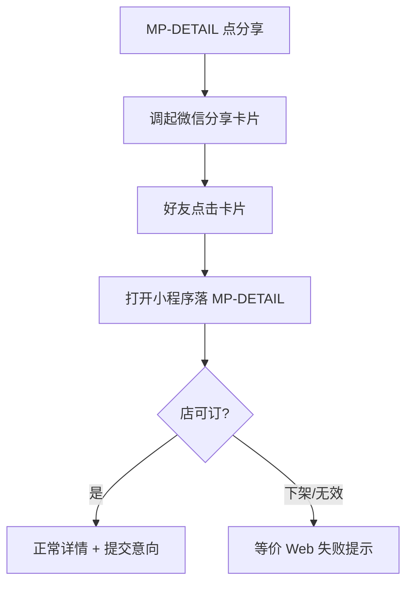

# 设计交付 · MVP-2 微信小程序（游客端）

| 项 | 内容 |
|----|------|
| 文档版本 | **MVP-2** |
| 对齐产品 | `PRODUCT-MVP-2-微信小程序-范围.md` · `PRODUCT-MVP-分期-已拍.md`（老板拍 **W-B**，已合入 api#28） |
| 日期 | **2026-10-18** |
| 维护 | 资深 UI/UE 设计执行 |
| 状态 | 可交付小程序线框实现；对齐验收 **C-MP1～C-MP8 + C-MP2b** |
| 品牌 | 主色沿用浅蓝 `#4BA3D9` / hover `#3A8FC4` / soft `#E8F4FC`；复用 `UI-TOKENS-MVP-0.md`；**禁绿色品牌** |
| 边界 | **仅游客微信小程序**；商家/运营仍 Web，**本包无商家/运营小程序页**；**无支付/定金/钱包 CTA**；不改意向状态机；CHECKED_IN 仅「已入住」；禁：已落实/已落地/已订立/已成交/已达成/已定着 |

---

## 1. 设计原则

沿用 MVP-0 / MVP-1 / MVP-1.5 全部原则，并增加小程序专用约束：

1. **先确认**：每个流程写清「用户 / 主任务 / 入口 / 出口」；一流程只服务一个主任务。
2. **每步写清**：可见信息、可操作、操作反馈。
3. **每页覆盖六态**：默认 / loading / empty / error / 无权限 / 校验失败 / **小屏·全面屏安全区**（替代 Web「窄屏」）。
4. **可达性**：对比度 ≥ WCAG AA；图必有可访问说明；触控热区 ≥ 44×44 pt；尊重安全区（刘海/底部横条）。
5. **复用**：统一设计 token（`UI-TOKENS-MVP-0.md`）；**不新增绿色品牌色**；不单开 UI-TOKENS 文件。
6. **文案**：用户语言；状态 + 下一步；处处强调「意向 ≠ 锁房」；CHECKED_IN 仅「已入住」。
7. **小程序专用**：
   - **端边界**：只做游客；不出现商家入驻、运营配置、买位入口。
   - **无支付**：路由、按钮、分享文案、客服话术触点均无支付/定金/钱包/收银台。
   - **Banner 对齐 MVP-1.5**：仅启用；`sortOrder` 越小越前；`ALL` 不受市 Chip；`CITY` 仅 OPEN；0 条隐藏区；1 静帧；≥2 轮播+指示点。
   - **外链 Banner**：站内路径用 `navigateTo`/`redirectTo`；外链优先 `web-view`（业务域名已配时），否则弹层「复制链接」+ 提示；须可到达所配目标（**C-MP4**）。产品 Q1 交 UI+工程，本文给出推荐定稿（见 §3.2 / §6 Q1）。
   - **列表筛**：至少「市」+「关键词」；仅 OPEN 市供给；CLOSED 不串脏（**C-MP3**）。
   - **账号与 Web 打通**（手机号或统一 userId，工程定）；未打通前不得假装意向已同步（**C-MP2b**）。
   - **分享卡片落到门店详情**（**C-MP7**）。
   - **攻略只读**：列表+详情；无问答/专题入口（**C-MP6**）。

---

## 2. 角色与主任务（本包）

| 角色 | 主任务（本包一件事） | 成功出口 | 明确不能做 |
|------|---------------------|----------|------------|
| 游客（未登录） | 在微信内发现 OPEN 市农家乐、看详情与攻略、拨打客服 | 进入微信登录以提交意向，或拨打电话 | 提交意向；商家/运营能力；支付 |
| 游客（已登录） | 提交意向 → 拿单号 → 我的意向只读核对；分享门店卡片 | 成功页（单号+客服电话+非锁房）；分享好友可开详情 | 改状态、支付、自助取消（默认）；假装未打通账号已同步意向 |
| 商家 | — | — | **本包无小程序页、无入口**（继续 Web） |
| 运营 | — | — | **本包无小程序页**；Banner/攻略/开城仍 Web 配置 |

---

## 3. 关键流程

### 3.1 MP-FUNNEL：首页 → 找店 → 详情 → 登录? → 意向 → 成功 → 我的意向



**ASCII：**

```
打开首页 → Banner(可选) / 找店 / 攻略 / 客服电话
  → 列表选店 → 详情
      → [未登录则微信登录/补全手机号]
      → 意向表 → 成功页(单号+客服+非锁房) → 我的意向
  → 分享卡片 → 好友打开 → 门店详情
并行: 攻略列表 → 攻略详情（只读，无问答/专题）
外链 Banner: web-view 或「复制链接」弹层（须可达目标）
```

| 项 | 内容 |
|----|------|
| 用户 | 游客 |
| 主任务 | 在微信内完成「发现 → 提交意向 → 知悉未锁房」并可用「我的意向」核对 |
| 入口 | 小程序启动页 / 分享卡片 / 扫码 |
| 出口 | 意向成功页；或失败态（不可订）；分享落详情 |

---

### 3.2 MP-BANNER：首页 Banner 展示与点击（对齐 MVP-1.5）



| 项 | 内容 |
|----|------|
| 用户 | 游客 |
| 主任务 | 发现运营活动/引导并到达所配目标（C-MP4） |
| 入口 | MP-HOME Banner 区（顶区、找店入口之上） |
| 出口 | 站内页 / web-view / 复制链接后由用户用系统浏览器打开 |

**展示集合过滤（与 Web MVP-1.5 同口径）：**

1. 仅 `enabled=true`。
2. `scope=ALL`：一律入集（**与当前所选市无关**）。
3. `scope=CITY`：仅当目标市 `openStatus=OPEN` 时入集；CLOSED → **不展示**。
4. 入集后按 **sortOrder 升序**（越小越前）。

**条数表现：**

| 条数 | 表现 |
|------|------|
| 0 | **整块 Banner 区不渲染**；不占位、不挡找店主路径 |
| 1 | 单图静帧；整图可点；无指示点、无自动切 |
| ≥2 | 横向轮播；约 **5s** 自动下一张；触滑 + 底部指示点；用户触控时暂停自动 |

**外链推荐定稿（对产品 Q1）：**

| 链接形态 | 行为 |
|----------|------|
| 站内路径（如 `/pages/list/index?city=yangzhou` 或业务约定的内部 path） | `wx.navigateTo` 或 `wx.redirectTo`（按栈深与是否需返回定） |
| `http(s)://` 且已配置业务域名 | 跳转 **MP-WEBVIEW**，`src`=该 URL |
| `http(s)://` 且未配业务域名 / web-view 不可用 | 半屏弹层：展示链接摘要 + Primary「复制链接」+ 说明「将在浏览器中打开」；复制成功 Toast「已复制，请到浏览器粘贴打开」 |
| 无效/空链接 | 不响应或 Toast「暂无法打开」；**不挡首页其他模块** |

须保证运营所配目标在体验版可验证到达（C-MP4）。

---

### 3.3 MP-SHARE：分享门店卡片 → 详情



| 项 | 内容 |
|----|------|
| 用户 | 分享者（已/未登录均可触发分享）；打开者（游客） |
| 主任务 | 获客卡片落到**该店详情**（C-MP7） |
| 入口 | 详情页分享按钮 / 右上角胶囊菜单「转发」 |
| 出口 | 打开者进入 MP-DETAIL（带门店 id） |

**卡片字段建议：** 见 `UI-PAGES-MVP-2-微信小程序.md`「分享卡片」节；标题用店名，路径必须带门店 id。

---

### 3.4 MP-LOGIN：微信登录 / 补全手机号

| 项 | 内容 |
|----|------|
| 用户 | 未登录游客 |
| 主任务 | 完成微信授权（及必要的手机号补全），回到原业务目标 |
| 入口 | 提交意向拦截、我的意向拦截、底栏「我的」未登录态 |
| 出口 | `redirect` 回意向表或详情或「我的意向」；失败留页 |

**步骤（UI 留位，工程定实现）：**

1. 微信授权登录（`wx.login` / 用户信息能力按当前微信规范）。
2. 若账号体系要求手机号：展示「补全手机号」步骤（授权手机号按钮或表单输入，工程二选一）。
3. 与 Web 打通字段写入会话后，再进入原目标；**未打通完成前，「我的意向」不得展示伪同步数据**（C-MP2b）。

---

## 4. 业务规则（UI 必须体现）

| # | 规则 | UI 体现 |
|---|------|---------|
| 1 | 仅游客小程序；商家/运营配置不可达 | 无商家入驻入口、无运营配置入口、无买位；底栏仅游客三项 |
| 2 | 仅 OPEN 市上架供给；CLOSED 不串脏 | 市筛选仅 OPEN；列表 API/前端双保险；南通等 CLOSED 不可选或不出现（C-MP3） |
| 3 | Banner 对齐 MVP-1.5 | 见 §3.2；启停即时；排序越小越前（C-MP4 / C-MP5） |
| 4 | 账号与 Web 打通；未打通不假装同步 | 登录后可提交；我的意向仅展示本端可证数据；打通提示见 §5.3（C-MP2b） |
| 5 | 意向规则/状态码/文案与 Web 一致 | 状态 Tag 同 MVP-0；CHECKED_IN=「已入住」；非锁房文案同触点 |
| 6 | 分享落到门店详情 | onShareAppMessage path 指向 MP-DETAIL（C-MP7） |
| 7 | 攻略只读；无问答/专题 | MP-GUIDE-* 无评论/问答/专题入口（C-MP6） |
| 8 | 硬锁无支付；不改状态机 | 全路径巡检（C-MP8） |

**意向状态游客文案（与 Web 同）：**

| 状态码 | 游客可见 | 下一步提示 |
|--------|----------|------------|
| 待跟进 | 待客服跟进 | 请保持电话畅通 |
| 已确认 | 已确认（约定中） | 按客服约定到店；仍非在线锁房 |
| 已改期 | 已改期 | 等待客服再次确认 |
| 已入住 | **已入住** | 如有疑问联系客服 |
| 已关闭 | 已关闭 | 可重新浏览并提交新意向 |

**严禁展示：** 已落实 / 已落地 / 已订立 / 已成交 / 已达成 / 已定着。

---

## 5. 关键交互说明

### 5.1 登录拦截

| 场景 | 行为 |
|------|------|
| 未登录点「提交意向」 | → MP-LOGIN；成功后进入 MP-INTENT-FORM（或回详情再点，推荐直接进表并带店 id） |
| 未登录进「我的意向」 | → MP-LOGIN；成功后进 MP-MY-INTENTS |
| 未登录浏览首页/列表/详情/攻略 | **允许**；不强制登录 |
| 已登录访问登录页 | 重定向首页或原 redirect |

### 5.2 Banner（摘要）

- 位置：首页顶区（导航/状态栏下），**找店入口与攻略入口之上**。
- 0 / 1 / ≥2 规则见 §3.2。
- 外链：web-view 优先，否则复制链接弹层；站内 navigateTo/redirectTo。
- ALL 不受当前市筛选影响；CITY 仅 OPEN。

### 5.3 账号打通提示

| 场景 | UI |
|------|-----|
| 打通方案已上线且绑定成功 | 「我的意向」正常拉两端同一主体数据；可轻提示「与网页版账号已关联」（可选，默认可不做） |
| 打通未完成 / 工程灰度中 | 「我的意向」**仅展示本小程序会话可证明的数据**；页顶 Info Banner：「网页版意向同步即将开通，当前仅显示本端提交的意向」——**禁止**伪造「已从 Web 同步」空列表伪装 |
| 手机号补全中断 | 停留补全步骤；不可跳过进入需登录的意向提交 |

主键：手机号绑定 **或** 统一 userId（产品 Q3，交工程写入 TECH）；UI 不写死字段名。

### 5.4 分享

- 详情页提供明确「分享」按钮（除胶囊菜单外）。
- 卡片 title：店名；path：详情页 + id；imageUrl：首图或默认品牌图。
- 打开无效/下架店：等价 Web「已下架或不可用」类提示，隐藏/禁用提交意向。

### 5.5 底栏（IA 定稿）

**推荐：三 Tab**，减认知负担；攻略从首页入口进入即可。

| Tab | 文案 | 对应页 | 说明 |
|-----|------|--------|------|
| 1 | 首页 | MP-HOME | Banner + 找店入口 + 攻略入口 + 客服电话 |
| 2 | 找店 | MP-LIST | 市 + 关键词筛；仅 OPEN |
| 3 | 我的 | MP-MY-INTENTS（未登录则登录墙） | 我的意向列表；可扩展「客服电话」入口 |

**不推荐四 Tab（含攻略）作为默认**：攻略非主转化路径，占底栏会稀释「找店/意向」。若产品后期坚持四 Tab，须另开修订；本包以三 Tab 验收。

非 Tab 页（详情、意向表、成功、攻略详情、登录、webview）用导航栏返回，不显示底栏或按微信惯例隐藏。

---

## 6. 开放问题（Q1 / Q2 / Q3）

| # | 问题 | 产品默认 | 本文结论 | 状态 |
|---|------|----------|----------|------|
| **Q1** | 外链 Banner 在小程序内打开方式？ | 按微信规范（web-view 或复制/提示）；UI+工程定 | **推荐**：站内 `navigateTo`/`redirectTo`；外链优先 **MP-WEBVIEW**（业务域名已配）；否则弹层「复制链接」+ 提示。须可达（C-MP4） | ✅ UI 推荐已定；工程配域名后选用 web-view 路径 |
| **Q2** | 列表筛选项子集？ | 至少市 + 关键词；其余对齐 Web 子集 | **本包必做**：市（仅 OPEN）+ 关键词；**可选增量**（不挡验收）：排序（综合/距离若有数据）；不做支付相关筛 | ✅ UI 已定最小集 |
| **Q3** | 打通主键？ | 手机号或统一 userId，工程选一种写 TECH | UI 留「微信授权 → 补全手机号」步骤；不写死主键；未打通不假装同步（C-MP2b） | 交工程 |

无开放问题挡 UI 开工；域名与登录字段以 TECH 为准。

---

## 7. 硬锁

| 锁 | 说明 |
|----|------|
| 仅游客端 | 无商家端小程序页；无运营后台小程序页 |
| 无支付 / 定金 / 钱包 | 路由、按钮、文案、分享语均无 |
| 意向 ≠ 锁房 | 成功页、意向表、我的意向必显非锁房说明 |
| CHECKED_IN | 仅「已入住」；禁已落实/已落地/已订立/已成交/已达成/已定着 |
| 不改 Web 意向状态机 | 小程序只多端展示与创建；合法迁移仍仅运营 Web |
| Token | 复用 MVP-0；Brand `#4BA3D9`；**禁用**田园绿 `#2F6B4F` 作品牌色 |
| CLOSED 不串脏 | 市筛与列表不得出现 CLOSED 市供给 |
| 攻略 | 只读；无问答/专题 |

---

## 8. 页面清单（`MP-` 前缀）

| ID | 页面 | 路由建议（pages） | 鉴权 | 底栏 |
|----|------|-------------------|------|------|
| MP-HOME | 首页（Banner + 找店入口 + 攻略入口 + 客服电话） | `/pages/home/index` | 公开 | ✓ |
| MP-LIST | 找店列表 | `/pages/list/index` | 公开 | ✓ |
| MP-DETAIL | 门店详情（含分享） | `/pages/detail/index?id=` | 公开 | ✗ |
| MP-LOGIN | 微信登录 / 补全手机号 | `/pages/login/index` | 游客 | ✗ |
| MP-INTENT-FORM | 提交意向 | `/pages/intent/form?listingId=` | 须登录 | ✗ |
| MP-INTENT-SUCCESS | 意向成功 | `/pages/intent/success?id=` | 须登录（本人） | ✗ |
| MP-MY-INTENTS | 我的意向列表 | `/pages/my/intents` | 须登录 | ✓（我的） |
| MP-MY-INTENT-DETAIL | 我的意向详情 | `/pages/my/intent-detail?id=` | 须登录（本人） | ✗ |
| MP-GUIDE-LIST | 攻略列表 | `/pages/guide/list` | 公开 | ✗ |
| MP-GUIDE-DETAIL | 攻略详情 | `/pages/guide/detail?id=` | 公开 | ✗ |
| MP-WEBVIEW | 外链容器（可选） | `/pages/webview/index?url=` | 公开 | ✗ |

**本包无商家/运营小程序页。**

详页规格见 `UI-PAGES-MVP-2-微信小程序.md`。

---

## 9. 文案硬约束

### 9.1 必须出现

| 触点 | 文案方向 |
|------|----------|
| 意向表顶 Banner | 「提交意向后，客服会联系您确认。**意向不等于已锁房。**」 |
| 成功页 | 「意向已提交（单号 {no}）。客服电话：{配置}。**请等待确认，当前未锁房。**」 |
| 我的意向列表/详情 | 「未锁房，以客服确认为准」；CHECKED_IN 显示「已入住」 |
| 详情主 CTA | 「提交意向」；副文「客服确认后安排，非即时订成」 |
| 不可订 | 「该房源暂不可提交意向」 |
| 外链复制弹层 | 「复制链接后，请在手机浏览器中打开」 |
| 未打通提示（若需） | 「网页版意向同步即将开通，当前仅显示本端提交的意向」 |

品牌占位：**站点名称**；客服电话占位：`400-000-0000`（读配置）。

### 9.2 禁用

| 禁止 | 说明 |
|------|------|
| 支付、收银台、去付款、在线支付、定金、订金、预付、钱包 | 本包无支付 |
| 已订房、已锁房、锁定成功、预订成功 | 成功态只用「意向已提交」 |
| 已落实 / 已落地 / 已订立 / 已成交 / 已达成 / 已定着 | 文案硬禁 |
| 商家入驻、广告位配置、买位、竞价 | 非本端 |
| 问答、专题、评论入口（攻略） | C-MP6 |

---

## 10. 前端实现注意点

### 10.1 路由与 page id

- 上表 page id 与路径建议供工程落 `app.json`；字段名以后端契约为准。
- TabBar：首页 / 找店 / 我的；选中色 Brand `#4BA3D9`。
- 分享：`onShareAppMessage` / `onShareTimeline`（若做朋友圈，path 仍须落详情；朋友圈能力以微信类目为准，不挡 C-MP7）。

### 10.2 列表筛选（对 C-MP3 / Q2）

- **必做**：市 Select（仅 OPEN 市）+ 关键词 Input。
- 切换市或搜索：重置列表分页；空态「该市暂无上架农家乐」或「未找到相关门店」。
- CLOSED 市：不出现在下拉；若深链带 CLOSED cityCode → 提示并回退默认 OPEN 市或清空，**不展示脏数据**。

### 10.3 Banner（对 C-MP4 / C-MP5）

```
展示集 = enabled
  ∩ (scope==ALL ∨ (scope==CITY ∧ city.openStatus==OPEN))
  按 sortOrder 升序
```

- 接口失败：**静默隐藏** Banner 区，不挡找店。
- 轮播指示点当前帧用 Brand；尊重 `prefers-reduced-motion` 时停自动（若基础库可探测）。

### 10.4 登录与打通（对 C-MP1 / C-MP2b）

- 会话 token 存存储；过期清会话并二次拦截。
- 打通完成前：我的意向 API 若仅回本端，UI 按实展示；禁止前端合并伪造 Web 数据。
- 补全手机号步骤可跳过与否由工程/合规定；若产品要求必填，则校验失败红字，不可进意向提交。

### 10.5 意向创建失败（用户可见，同 Web）

| 场景 | 用户可见 |
|------|----------|
| 下架/不可订 | 「已下架或不可用」；禁用提交；不产生有效新单 |
| 业务冲突 | 「该房源当前不可提交意向…」；不产生有效新单 |
| 不存在 | 「房源不存在」 |
| 校验失败 | 字段级红字 |

### 10.6 安全区与小屏

- 使用 `safe-area-inset-*`；底栏、详情底栏 CTA、成功页主按钮避开 Home Indicator。
- 全面屏：顶部自定义导航需留状态栏高度；图集横滑。
- 触控：主 CTA 高度 ≥ 44pt；Banner 指示点可点区域放大。

### 10.7 无支付 / 无商家运营巡检（对 C-MP8）

- 全页面、分享文案、客服说明：无支付相关 CTA。
- 无「商家入驻」「广告位」「买位」入口。
- 意向状态机展示与 Web 一致；不出现非法迁移按钮。

---

## 11. 验收映射（C-MP1～C-MP8 + C-MP2b）

| 验收 ID | 设计对应 |
|---------|----------|
| **C-MP1** | 未登录点提交意向 → MP-LOGIN；登录后可进 MP-INTENT-FORM 完成提交 |
| **C-MP2** | 提交成功 → MP-INTENT-SUCCESS 含单号 + 客服电话 + 非锁房文案；MP-MY-INTENTS 可见 |
| **C-MP2b** | 打通后两端「我的意向」可见同一单；未打通不假装同步（§5.3） |
| **C-MP3** | MP-LIST 市筛仅 OPEN；CLOSED 不串脏 |
| **C-MP4** | 启用 ALL Banner 首页可见；点击可达所配目标（站内跳转 / web-view / 复制）；停用刷新后消失 |
| **C-MP5** | ≥2 条启用不同 sortOrder → 展示/轮播起始序越小越前 |
| **C-MP6** | MP-GUIDE-LIST/DETAIL 可阅读；无问答/专题入口 |
| **C-MP7** | 分享卡片打开落到该店 MP-DETAIL |
| **C-MP8** | 全路径无支付/定金/钱包；无商家/运营配置入口；CHECKED_IN 仅「已入住」 |

---

## 12. 关联交付

| 文件 | 内容 |
|------|------|
| `UI-PAGES-MVP-2-微信小程序.md` | 各 MP- 页信息结构、六态、文案、分享卡片、底栏、与 Web 对照 |
| `UI-TOKENS-MVP-0.md` | 复用；本包不单开 tokens |
| `PRODUCT-MVP-2-微信小程序-范围.md` | 范围与验收 C-MP* |
| `DESIGN-MVP-1.5-广告位.md` | Banner 规则同源 |
| `DESIGN-MVP-0.md` | 意向状态机与非锁房文案同源 |

---

## 13. 改动点 / 影响点

| 类型 | 说明 |
|------|------|
| **新增** | 游客微信小程序整包：MP-HOME～MP-WEBVIEW；三 Tab IA |
| **多端复用** | 供给/意向/Banner/攻略口径对齐 Web；仅多端展示与登录 |
| **不改** | Web 意向状态机、CHECKED_IN「已入住」、支付边界、商家/运营 Web 页、Brand 色板 |
| **配置** | 小程序业务域名（web-view）；客服电话读站配；Banner/攻略仍运营 Web 配 |
| **风险** | ① 外链无法达 → C-MP4 失败（须 web-view 或复制兜底）；② CLOSED 市串脏 → C-MP3；③ 未打通却展示「已同步」→ C-MP2b；④ 分享 path 丢 id → C-MP7；⑤ 文案误用「已成交」等 → C-MP8 |
| **协作** | UI 定三 Tab、外链推荐、筛选项最小集；Q3 交工程；测试按 C-MP1～8 + C-MP2b |

---

## 14. 修订记录

| 版本 | 日期 | 说明 |
|------|------|------|
| MVP-2 | 2026-10-18 | 首版游客微信小程序设计交付；对齐老板 W-B；UI 定三 Tab、Banner 外链推荐、列表市+关键词；验收 C-MP1～8 + C-MP2b |
