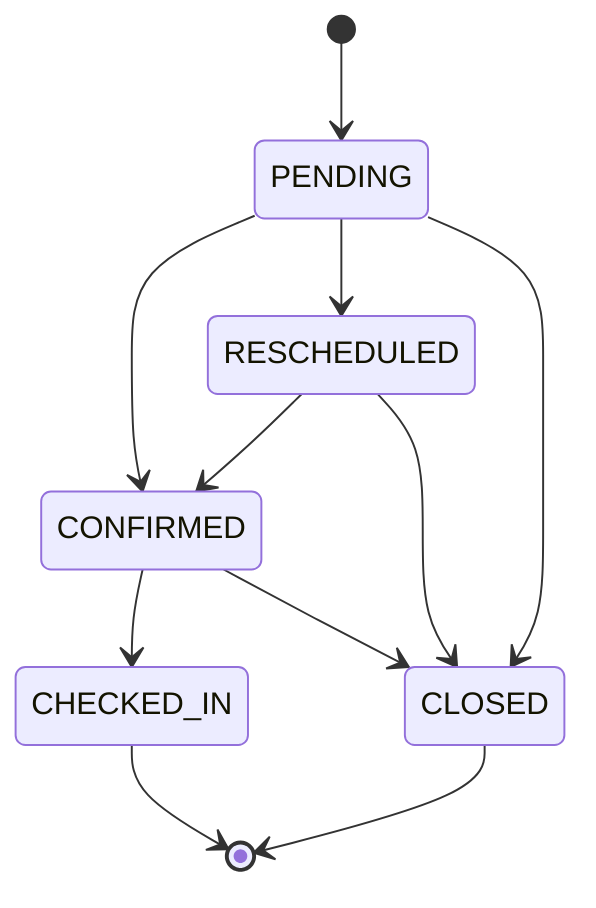

# 平台使用手册 · 三端操作教程

> 读者：运营人员、商家、游客（以及一线客服）
> 覆盖范围：MVP-0 ~ MVP-2（门户 / 商家 / 运营 + 微信小程序登录）
> 不包含：支付、定金、锁房、佣金、图片上传——本期明确不做
> 接口字段细节见 `docs/API-INDEX.md`；部署见 `docs/DEPLOYMENT.md`
> 最后更新：2026-10-20

页面菜单名称以你实际使用的前端为准，本文描述的是**每项操作对应的业务规则和结果**，这些规则由后端保证，换皮不影响。

---

## 0. 三端入口

| 端 | 谁用 | 能做什么 | 登录方式 |
|---|---|---|---|
| **门户** | 游客 | 逛首页、筛房源、看详情和攻略、提交预订意向、查我的意向 | 手机号 + 密码；或微信小程序授权 |
| **商家后台** | 农家乐经营者 | 维护本主体门店资料、申请上下架、查看本店意向 | 手机号 + 密码（由运营开通） |
| **运营后台** | 平台运营 | 审入驻、管商家和门店、跟进意向、发攻略、配站点和 Banner、开城、看数据 | 手机号 + 密码 |

### 0.1 演示账号（仅本地/测试环境）

| 端 | 手机号 | 密码 | 身份 |
|---|---|---|---|
| 运营 | `17606838920` | `123456` | 苏中运营（OPERATOR） |
| 商家 | `17606838921` | `123456` | 表弟 · 广陵表弟农家 |
| 游客 | `17606838922` | `123456` | 演示游客 |

> **对客上线前必须全部更换**，改法见 `docs/DEPLOYMENT.md` §11.4。种子里的门店和攻略只用于验收，不要直接当真实内容。

### 0.2 登录后的通用规则

- 登录成功返回一个令牌，前端后续请求放在 `Authorization: Bearer <令牌>`。
- 令牌有效期 **12 小时**，且**只存在服务进程内存里**。后端一重启，所有人都要重新登录——发布时请提前通知。
- 三种角色互相隔离：游客令牌打不开运营接口，会返回 403；未登录返回 401。

---

## 1. 游客端（门户 + 小程序）

### 1.1 注册与登录

1. 门户点「登录/注册」，输入 11 位手机号。
2. 注册时设密码，长度 **6–64 位**；昵称可空，最长 64 字。
3. 已有账号直接登录。密码错误提示「手机号或密码错误」。

> 目前**没有短信验证码**，注册不校验手机号真实性。请勿用他人手机号注册。

### 1.2 微信小程序登录与绑定手机号

1. 小程序内授权登录，系统按 openid 自动创建或复用游客账号（同一微信重复登录还是同一个用户）。
2. 登录成功后可以正常浏览，但**提交意向必须先绑定手机号**。
3. 绑定方式二选一：
   - 填手机号 + 密码（与网页版账号打通）；
   - 用微信手机号快捷授权。
4. 绑定成功会换发新令牌，之后网页版和小程序看到的是同一份「我的意向」。

常见提示：

| 提示 | 含义 | 处理 |
|---|---|---|
| 微信登录未配置（503） | 服务端没配 AppID/Secret | 找技术配置，不是用户问题 |
| 请先绑定手机号… | 账号没有手机号 | 完成 §1.2 绑定后再提交 |

### 1.3 逛首页

- 顶部 Banner 由运营配置；**全站 Banner 一直展示，指定城市的 Banner 只在该市仍开通时展示**，按排序值升序，数字小的在前。
- 目的地 Chip **只显示已开通的城市**。没有开通的城市不会出现，也不会出现「敬请期待」的空壳。
- 首页推荐只包含已开通城市里、已上架的门店。

### 1.4 找房源

列表支持：

| 筛选项 | 说明 |
|---|---|
| 地区 | 省 → 市 → 区县；未开通的市筛选后是空列表，不会串到别的城市 |
| 标签 | 如亲子、江鲜、院落 |
| 价格带 | 最低价 / 最高价 |
| 排序 | 综合 `comprehensive`、价格升序 `price_asc`、价格降序 `price_desc` |
| 关键词 | 匹配店名，**最多 64 字**，超出会提示「参数不正确」 |

列表只展示**已开通城市 + 已上架**的门店。抓取或导入的测试房源会带「测试」标记。

### 1.5 看房源详情

- 套餐说明以门店的 **套餐文案（packageText）** 为准；套餐明细表可能为空，属正常。
- 如果门店已下架，或所属城市已关闭，详情返回 **410「已下架或不可用」**。此时不要引导用户下单，按「暂不可订」展示。

### 1.6 提交预订意向

填写：房源、到店日期、晚数、人数、联系人、联系电话、备注。

| 字段 | 规则 |
|---|---|
| 到店日期 | 必填 |
| 晚数 | ≥ 1 |
| 人数 | ≥ 1 |
| 联系人 | 必填，≤ 64 字 |
| 联系电话 | 必填，11 位手机号 |
| 备注 | 可空，≤ 500 字 |

**这不是下单，也没有付款。** 提交后只是把意向交给平台，运营或商家会电话联系确认。系统不锁房、不扣款、不生成订单号。

提交前必须已绑定手机号（见 §1.2），否则返回 403 并提示先绑定。

### 1.7 我的意向

只显示自己的意向，别人的详情一律 404。状态含义：

| 状态 | 中文 | 含义 |
|---|---|---|
| `PENDING` | 待跟进 | 刚提交，平台还没联系 |
| `CONFIRMED` | 已确认 | 已和商家敲定到店安排 |
| `RESCHEDULED` | 已改期 | 改过日期，需要重新确认 |
| `CHECKED_IN` | 已入住 | 已实际到店，终态 |
| `CLOSED` | 已关闭 | 取消或无效，终态 |

游客端**不能自己改状态**，只能看；状态由运营在后台推进。

### 1.8 攻略

- 列表只显示**已发布**的攻略，草稿不可见。
- 已发布攻略的直链即使城市后来关闭了，仍然能打开（内容不会凭空消失）。

---

## 2. 商家端

### 2.1 提交入驻申请

在门户找到「商家入驻」，填写：

| 字段 | 必填 | 规则 |
|---|---|---|
| 主体名称 | 是 | ≤ 128 字，如「广陵表弟农家」 |
| 联系人 | 否 | ≤ 64 字 |
| 联系电话 | 否 | 填了就必须是 11 位手机号，否则提示格式错误 |
| 拟开门店名 | 否 | ≤ 128 字，仅供运营参考，不校验重名 |
| 意向地区 | 否 | 必须是系统里存在且启用的地区 |
| 介绍 | 否 | ≤ 1000 字 |

允许重复提交，同一手机号可以多次申请。提交后**不会自动开通**，等运营审核。

### 2.2 账号开通与登录

运营审核通过后，系统会生成商家账号，**初始密码只在通过那一刻显示一次**，请运营当场记下转交。忘记密码只能让运营重置。

登录失败的两种常见情况：

| 提示 | 原因 |
|---|---|
| 手机号或密码错误（401） | 密码不对，或账号还没开通 |
| 主体或账号已停用（403） | 运营停用了主体/账号，联系运营 |

### 2.3 门店资料维护

- 只能看到**本主体**名下的门店，看不到别家。
- 可以修改：门店名称、所在地区、地址、电话、封面图 URL、图集、价格文案、起价、**套餐文案**、设施、特色、须知、交通说明。
- **不能**修改：上下架状态、首页推荐、首页排序。这三项归运营。
- 保存时必须带当前版本号。如果提示「数据已被修改」，说明有人（通常是运营）在你编辑期间改过这家店，**刷新页面重新编辑**，不要反复提交。

> 图片只填 URL，系统没有上传功能。请先把图片放到图床或对象存储。

### 2.4 申请上架 / 下架

1. 门店详情页点「申请上架」或「申请下架」，填写理由。
2. 同一家店**同时只能有一条待审申请**，重复提交会被拒绝，等运营处理完再提。
3. 运营通过后，门店状态才会真正变化；驳回会带原因，修改后可重新申请。

如果情况紧急（比如卫生检查要求立刻下架），直接联系运营，运营可以在后台强制改状态，那一步会留审计记录。

### 2.5 查看意向

- 只能看**本店**的意向，只读，不能改状态、不能导出。
- 联系电话**中间四位脱敏**。需要完整号码请联系运营。

### 2.6 商家常见问题

| 问题 | 原因 / 处理 |
|---|---|
| 登录后一家店都没有 | 主体下还没建店；运营审核通过时不一定同时建店，联系运营代建 |
| 找不到「新增门店」 | 设计如此，商家端没有建店功能 |
| 改完价格门户没变 | 首页推荐和门店详情有 5 分钟缓存，等一会儿或让运营清缓存 |
| 申请提交不了 | 该店已有待审申请，等运营处理 |

---

## 3. 运营端（重点）

运营后台是整个平台的控制台。除登录外，所有接口都要求运营角色（`OPERATOR` 或 `AGENT`）。

建议按这个顺序熟悉：**入驻审核 → 商家主体 → 门店 → 上下架审批 → 意向跟进 → 攻略 → 站点配置 / Banner → 开城 → 数据看板**。

### 3.1 登录与身份

- 手机号 + 密码登录，页面右上角可看当前登录人和角色。
- 令牌 12 小时过期，过期后重新登录；服务重启也会失效。
- 用 `GET /api/admin/auth/me` 可以核对当前身份。

### 3.2 入驻审核

1. 打开「入驻申请」，默认看 `PENDING` 待审队列，也可按 `APPROVED` / `REJECTED` 筛。
2. **通过**：系统创建商家主体和登录账号。可以自己指定初始密码（**8–64 位**），不填则系统生成。**明文密码只在本次响应里出现一次**，请立刻复制转交，页面关了就拿不到了。
3. **驳回**：必须填原因，原因会展示给申请人。已处理的申请不能重复处理（返回 409）。

### 3.3 商家主体管理

| 操作 | 效果 |
|---|---|
| 查看主体列表 | 按 `ACTIVE` / `DISABLED` 筛选 |
| 停用主体 / 停用账号 | 立即生效，**该主体已登录的令牌同时失效**，对方下次请求就是 403 |
| 重置密码 | 可指定新密码（8–64 位），明文同样只显示一次 |
| 代建门店 | 给该主体新建门店并自动绑定；不填状态默认 `DRAFT`、不推荐、排序 100 |

停用是可逆的，重新启用后对方可以再登录（需要重新登录，旧令牌不会复活）。

### 3.4 门店管理

- 门店列表可按上下架状态、地区、所属主体、是否首页推荐、店名筛选。
- **代编辑**是整单保存：把当前表单完整提交，并带上版本号。版本不一致返回 409「数据已被修改」——刷新重来。
- **代上下架**：直接在编辑里改上下架状态，**立即生效**，不走申请队列，并写入一条 `SHELF_FORCE` 审计。这是紧急通道，日常请让商家走申请。
- **首页推荐**：勾选推荐 + 设置排序（0–100000，越小越前）。只有所属城市已开通的门店才会真正出现在首页。
- **测试数据标记**：`test_data=true` 的门店会带「测试」标，且**不计入开城供给数**。抓取或导入的房源必须标测试。

### 3.5 上下架申请审批

1. 打开「上下架申请」队列，可按状态、门店、主体筛选。
2. 通过：门店上下架状态立即变更。
3. 驳回：必须填原因；门店状态不变，游客看到的内容不受影响。

### 3.6 意向跟进（日常最主要的工作）

#### 状态机

规则：

- 新建意向固定是**待跟进**。
- **已入住**和**已关闭**是终态，不能再改成任何状态。
- 不能跳级：待跟进不能直接改「已入住」，必须先「已确认」。
- 非法迁移返回 409，页面会提示冲突。
- **只有运营能改状态**，商家和游客只能看。

#### 操作要点

| 操作 | 说明 |
|---|---|
| 筛选 | 按状态、门店、主体、入住日期区间、提交时间区间 |
| 详情 | 看完整手机号 + 全部备注时间线 |
| 改状态 | 选目标状态，可附一条备注；系统自动追加一条状态变更记录 |
| 加备注 | 只追加，不能编辑或删除历史备注 |
| 导出 CSV | 筛选条件与列表一致，UTF-8 BOM，Excel 可直接打开；**没有佣金列** |

> 状态里的「已入住」在部分页面文案写作「已落实」，指的是同一件事：游客实际到店。

### 3.7 攻略管理

- 新建/编辑：标题、封面 URL、摘要、正文、状态（草稿 `DRAFT` / 已发布 `PUBLISHED`）、所属地区。
- **只有已发布**的攻略会出现在门户列表；草稿仅后台可见。
- 删除是不可逆的，删之前确认没有对外链接。
- 攻略建议挂到**市或区县**。挂到「省」的攻略不计入任何城市的开城攻略数（见 §3.10）。

### 3.8 站点配置

当前可改三项：

| 项 | 说明 |
|---|---|
| 站名 | 门户标题、页头展示 |
| 主色 | 十六进制色值，默认 `#4BA3D9` |
| 客服电话 | 门户展示的联系电话 |

英文辅文、副标、Logo、favicon 四项**技术方案已定但还没上线**，现在改不了，不要在前端留空入口。

改完门户有 30 分钟缓存，等一会儿或重启后生效。

### 3.9 首页 Banner

| 字段 | 规则 |
|---|---|
| 标题 | ≤ 64 字，可空 |
| 图片 URL | 必填，只收 URL，**没有上传** |
| 跳转链接 | 必填，站内路径或完整 URL |
| 投放范围 | `ALL` 全站 / `CITY` 指定城市 |
| 投放城市 | 范围为 `CITY` 时必填 |
| 排序 | 数字越小越靠前 |
| 启用 | 只有启用的才展示 |

关键规则：

- 全站 Banner 一直展示；指定城市的 Banner 只在**该市当前仍开通**时展示。
- 启用一条投放到已关闭城市的 Banner 会返回 **409**，先把城市开通或改成全站。
- 删除是**物理删除**，不可恢复，历史投放记录也没了。通常用「停用」就够了。
- 没有曝光统计、点击统计，也没有买位功能。
- Banner 不进首页 feed 缓存，启用/停用/改排序后刷新门户即可看到（浏览器强缓存的话按 Ctrl+F5）。

### 3.10 开城（最容易出错，重点看）

开城的单位是**地级市**；区县只作为筛选项，不单独开城。

#### 五项条件

| # | 条件 | 谁决定 |
|---|---|---|
| ① | 目的地数据已备好 | 运营手勾 |
| ② | 供给达标：上架且非测试门店数 ≥ 5（`minStores`） | **系统实时计数，不能手改** |
| ③ | 攻略达标：已发布攻略数 ≥ 1（`minArticles`） | **系统实时计数，不能手改** |
| ④ | 客服已覆盖 | 运营手勾 |
| ⑤ | 测试数据 / 脏数据已清理 | 运营手勾 |

计数口径：

- 门店：`ON_SHELF` 且 `test_data=false`，归属该市本级或该市下辖区县。
- 攻略：`PUBLISHED`，归属同样是市本级或下辖区县。
- **挂在「省」下的门店和攻略不计入任何城市。**

#### 操作流程

1. 打开「开城」，看列表里每个市的开通状态、门店数、攻略数。
2. 进单市详情，补齐数据 → 勾选①④⑤。
3. 系统自动判定②③；页面上这两项是只读的，**强行提交会被 400 拒绝**（提示「供给达标与攻略达标按实时计数自动勾选，不能手改」）。
4. 五项全绿后点「开通」。未达标返回 **409「未达标，不能开通：…」**，缺项按「目的地 → 供给 → 攻略 → 客服 → 测数」的固定顺序列出，没有「强制开通」。
5. 开通成功后，门户的目的地 Chip、列表、首页推荐立刻能看到该市（缓存会在事务提交后失效）。

#### 关城

- 只有已开通的市能关；重复关返回 409「该市未开通」。
- 关城**不删**门店、攻略、意向，也不停用地区，历史数据全保留。
- 关城后：门户不再露出该市房源和攻略；该市的 Banner 自动不再展示；已发布攻略直链仍可打开；已提交的意向仍可跟进。

#### ⚠️ 种子数据的坑

扬州、泰州、南通在种子数据里**就是已开通状态**，但种子只有 3 家门店，且唯一的攻略挂在「江苏省」而不是某个市，所以计数达不到 5 / 1。

**这意味着：你现在把扬州关掉，就开不回来了**，除非先补够 5 家上架非测试门店 + 1 篇归属该市的已发布攻略。

测试关城请用其他 `CLOSED` 城市，或者先补数再关。

### 3.11 数据看板

- 指标：意向数、已确认数、已入住数，按城市汇总。
- 时间窗：近 7 天、近 30 天、全部。
- 可只看某个城市。
- 支持导出 CSV，条件与页面一致。

### 3.12 运营端的边界

- 运营**不能**在后台给自己改密码（没有这个接口），需要技术改库。
- 运营**不能**上传图片。
- 运营**不能**发起支付、退款、结算——本期没有资金相关功能。
- 运营**不能**删除意向或门店，只能改状态 / 下架。

---

## 4. 状态与文案对照

| 枚举 | 中文 | 出现位置 |
|---|---|---|
| `DRAFT` | 草稿 | 门店上下架、攻略状态 |
| `ON_SHELF` / `OFF_SHELF` | 已上架 / 已下架 | 门店 |
| `PENDING` / `APPROVED` / `REJECTED` | 待审 / 已通过 / 已驳回 | 入驻申请、上下架申请 |
| `PUBLISHED` | 已发布 | 攻略 |
| `OPEN` / `CLOSED` | 已开通 / 未开通 | 城市 |
| `ALL` / `CITY` | 全站 / 指定市 | Banner 投放范围 |
| `PENDING` / `CONFIRMED` / `RESCHEDULED` / `CHECKED_IN` / `CLOSED` | 待跟进 / 已确认 / 已改期 / 已入住 / 已关闭 | 预订意向 |
| `TOURIST` / `MERCHANT` / `OPERATOR` / `AGENT` | 游客 / 商家 / 运营 / 代理 | 令牌角色 |

---

## 5. 错误码速查

| HTTP / code | 含义 | 常见场景 | 怎么办 |
|---|---|---|---|
| 400 | 参数不正确 | 手机号格式、关键词超 64 字、密码长度、手改②③ | 按提示改输入 |
| 401 | 未登录或令牌失效 | 令牌过期、服务重启 | 重新登录 |
| 403 | 无权限 | 角色不对、主体/账号停用、游客未绑手机号 | 换正确账号；停用找运营；绑定手机号 |
| 404 | 不存在 | 记录不存在、看别人的意向、未知路径（含 `/api/payments`） | 核对 ID / 路径 |
| 409 | 冲突 | 乐观锁版本过期、重复审核、未达标开城、Banner 投放市已关闭 | 刷新重试；先满足条件 |
| 410 | 已下架或不可用 | 门店下架、城市关闭 | 按「暂不可订」展示 |
| 503 | 服务未配置 | 微信 AppID/Secret 为空 | 找技术配置 |
| 500 | 服务器错误 | 未预期异常 | 记录时间和操作，找技术查日志 |

所有错误都返回 `{code, message, data:null}`，**先看 HTTP 状态，再看 message**。健康检查 `/health` 是唯一不走这套信封的接口。

---

## 6. 常见问题（FAQ）

**Q1：运营登录提示「手机号或密码错误」，但密码没记错？**
A：确认用的是**手机号**不是用户名（系统没有用户名字段，多传 `username` 会被拒绝）。测试环境初始密码是 `123456`；生产环境上线前改过密码，需要找技术确认。

**Q2：保存门店或开城清单时提示「数据已被修改」？**
A：乐观锁冲突，说明页面上的版本号已经过期（别人先改了）。刷新页面拿到最新数据再改，不要连续点保存。

**Q3：修改开城清单提示「供给达标与攻略达标按实时计数自动勾选，不能手改」？**
A：正常的保护逻辑。②③只能靠补门店和攻略来达标，不能手勾。

**Q4：开城一直 409，缺项也都勾了？**
A：看缺项文案里的数字。常见原因是门店是 `test_data=true`（不计入）、门店还是 `DRAFT` 没上架、或攻略挂在省而不是市。

**Q5：Banner 启用报 409？**
A：这条 Banner 投放到某个已关闭的城市。改成全站，或先把该市开通。

**Q6：游客提交意向提示 403「请先绑定手机号」？**
A：微信授权登录的账号默认没有手机号。先完成手机号绑定，再提交。

**Q7：门户列表里搜不到某个城市的店？**
A：该市未开通，或门店未上架，或门店被标了测试数据。三者取其一。

**Q8：导出的 CSV 打开是乱码？**
A：文件是 UTF-8 BOM，正常 Excel 双击应该正常。如果还是乱码，用 Excel「数据 → 从文本/CSV」并选 UTF-8。

**Q9：改完价格/Banner，门户没变化？**
A：门店价格在详情缓存里，5 分钟后生效；Banner 不进缓存，刷新即可（必要时 Ctrl+F5）；站点配置 30 分钟。地区数据 30 分钟。

**Q10：发布后所有人都要重新登录？**
A：令牌存在进程内存，重启即失效。这是当前设计，不是 bug。发布请安排在低峰期并提前通知商家。

**Q11：商家说忘记密码？**
A：运营在「商家主体」里重置，新密码只显示一次，当场转交。

**Q12：能不能直接在后台收定金？**
A：不能。本期没有支付、定金、锁房、佣金，所有相关路径返回 404。意向只是线索，成交在线下完成。

---

## 7. 本期不提供（避免误期待）

| 功能 | 状态 | 替代做法 |
|---|---|---|
| 在线支付 / 定金 / 退款 | 不做，接口 404 | 线下沟通、线下收款 |
| 图片上传 | 不做，只收 URL | 用对象存储 / 图床，把链接填进来 |
| 短信验证码 | 不做 | 手机号 + 密码注册 |
| 商家自助建店 | 不做 | 运营代建 |
| 商家自助改密 | 不做 | 运营重置 |
| 运营自助改密 | 不做 | 技术改库 |
| 多实例部署 | 不支持 | 单实例；令牌在内存 |
| 英文站名 / 副标 / Logo / favicon 配置 | 设计已定，未上线 | 暂用默认值 |
| 曝光 / 点击统计 | 不做 | 用 Nginx 访问日志粗看 |

---

## 8. 客服话术建议

- 游客问「为什么不能付款」：目前平台只提供预订意向，提交后会有人电话联系确认，不在线收款。
- 游客问「为什么这家店点进去显示不可用」：房源可能已下架，或该目的地暂停开放，可以看看同城其他房源。
- 商家问「为什么我不能自己上架」：上架需要平台审核，提交申请后运营会处理；紧急情况可直接联系运营。
- 商家问「为什么看不到游客完整手机号」：为保护游客隐私，商家端做了脱敏，成交由平台运营协助对接。
